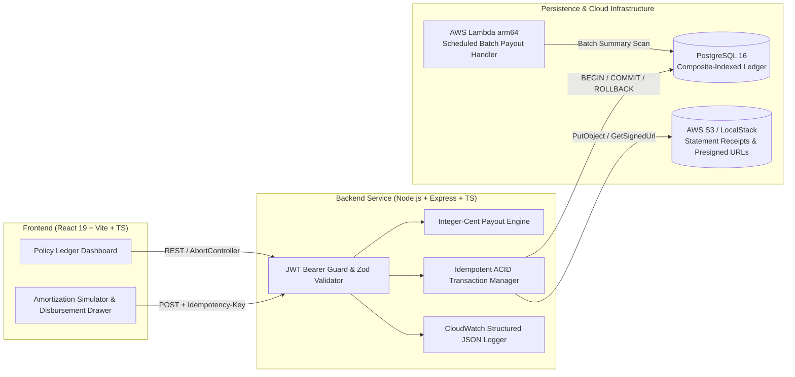
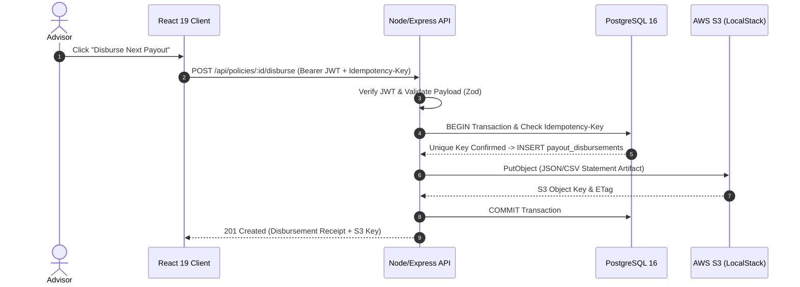

<div align="center">

# 🏦 Annuities Payout Platform

**Enterprise-Grade Financial Payout Engine, Idempotent ACID Ledger & Cloud Archival System**

[](https://www.typescriptlang.org/)
[](https://nodejs.org/)
[](https://react.dev/)
[](https://www.postgresql.org/)
[](https://www.docker.com/)
[](https://aws.amazon.com/)

[Architecture](#-system-architecture) • [Core Features](#-core-engineering-capabilities) • [API Reference](#-api-reference) • [Quick Start](#-quick-start) • [Project Structure](#-project-structure)

</div>

---

## 📖 Overview

The **Annuities Payout Platform** is a full-stack fintech application designed to modernize legacy batch annuity processing into a resilient, cloud-native microservice architecture. 

Built with **Node.js, TypeScript, React 19, PostgreSQL 16, Docker, and AWS (S3, Lambda, CloudWatch)**, the platform calculates deterministic multi-frequency annuity amortization schedules, executes idempotent ACID payout disbursements, archives verifiable statement receipts to S3, and provides real-time advisor simulation tools—all runnable locally at **$0 cost** via Docker and LocalStack (`lstk`).

---

## 🏗 System Architecture



### Idempotent Disbursement & S3 Statement Archival Sequence



---

## ✨ Core Engineering Capabilities

| Engineering Pillar | Implementation Details |
| :--- | :--- |
| **Integer-Cent Financial Math** | Computes monthly, quarterly, and annual annuity amortization schedules (`PMT = P * [r(1+r)^n] / [(1+r)^n - 1]`) using integer-cent rounding (`Math.round(amount * 100)`) and 0%-APR edge-case handling to eliminate IEEE-754 floating-point drift. |
| **Idempotent ACID Ledger** | Executes disbursements inside explicit `BEGIN` / `COMMIT` / `ROLLBACK` PostgreSQL transactions protected by `UNIQUE` `Idempotency-Key` constraints so network retries never double-disburse funds. |
| **Query Tuning & Indexing** | Eliminates N+1 database lookups via single-pass `LEFT JOIN` + `COALESCE(SUM(amount), 0)` aggregations backed by composite indexes on `(policy_id, scheduled_date DESC)`. |
| **S3 Statement Archival** | Archives disbursement receipts to Amazon S3 via `@aws-sdk/client-s3` and serves time-limited presigned URLs (`@aws-sdk/s3-request-presigner`), switching seamlessly between LocalStack (`lstk`) and AWS Free Tier. |
| **Observability & Serverless** | Emits single-line structured JSON logs (`requestId`, `route`, `statusCode`, `durationMs`) formatted for **AWS CloudWatch Logs Insights**, alongside an `arm64`-ready **AWS Lambda** batch summary handler. |
| **Security, Containers & CI/CD** | Protects payout mutations with stateless JWT verification (`jose`) and Zod schemas, ships a multi-stage non-root `node:22-alpine` Dockerfile, and enforces automated typechecks and `node:test` suites via GitHub Actions. |

---

## 🔌 API Reference

| Method | Endpoint | Auth | Description |
| :--- | :--- | :--- | :--- |
| `GET` | `/health` | Public | Verifies API and PostgreSQL database connectivity |
| `POST` | `/api/auth/dev-token` | Dev Only | Issues a signed development Bearer JWT for testing protected routes |
| `GET` | `/api/policies` | Public | Lists annuity policies with single-query aggregated disbursement totals |
| `POST` | `/api/payouts/calculate` | Public | Computes a deterministic amortization payout schedule (`MONTHLY`, `QUARTERLY`, `ANNUAL`) |
| `POST` | `/api/policies/:id/disburse` | Bearer JWT | Executes an idempotent ACID payout disbursement and archives statement to S3 |
| `GET` | `/api/disbursements/:id/statement-url` | Bearer JWT | Generates a time-limited presigned S3 URL to download the archived receipt |

---

## 🚀 Quick Start

### Prerequisites
* **Node.js** `v20+` & **npm**
* **Docker** (OrbStack or Docker Desktop)
* **AWS CLI** & **LocalStack (`lstk`)** *(for local S3/Lambda emulation)*

### 1. Clone & Configure Environment
```bash
git clone https://github.com/hibrahi000/annuities-payout.git
cd annuities-payout
cp server/.env.example server/.env
```

### 2. Install Dependencies & Initialize Local S3 Bucket
```bash
npm --prefix server install
npm --prefix client install

# Start LocalStack emulator and create the statements bucket
lstk
aws --profile localstack --endpoint-url=http://localhost:4566 s3 mb s3://annuities-payout-dev
```

### 3. Launch PostgreSQL, Backend API & React Dashboard
```bash
npm run dev:all
```
* **React Dashboard:** `http://localhost:5173`
* **Node/Express API:** `http://localhost:4000/health`
* **PostgreSQL 16:** `localhost:5432` (`annuities_dev`)

### 4. Run Automated Tests & Multi-Stage Docker Build
```bash
# Run unit tests for integer-cent payout calculations
npm --prefix server test

# Build production non-root API image & run full stack with healthchecks
docker compose --profile full up -d --build
```

---

## 📂 Project Structure

```text
annuities-payout/
├── .github/
│   └── workflows/
│       └── ci.yml                       # GitHub Actions CI (typecheck, unit tests, builds)
├── client/                              # React 19 + Vite + TypeScript frontend
│   └── src/
│       ├── api/
│       │   └── payoutApi.ts             # Typed fetch wrappers with AbortController
│       ├── components/
│       │   ├── PolicyTable.tsx          # Aggregated policy ledger table
│       │   └── PayoutSimulatorForm.tsx  # Interactive calculator & disbursement trigger
│       ├── App.tsx
│       └── main.tsx
├── server/                              # Node.js + Express + TypeScript microservice
│   ├── src/
│   │   ├── db/
│   │   │   └── pool.ts                  # PostgreSQL connection pool & schema bootstrap
│   │   ├── lambda/
│   │   │   └── batchPayoutHandler.ts    # AWS Lambda scheduled payout batch handler
│   │   ├── middleware/
│   │   │   ├── auth.ts                  # Stateless JWT Bearer guard (jose)
│   │   │   ├── errorHandler.ts          # Centralized JSON error envelope
│   │   │   └── validate.ts              # Reusable Zod schema validation middleware
│   │   ├── routes/
│   │   │   ├── policies.ts              # Aggregated policy queries & ACID disbursements
│   │   │   └── payouts.ts               # Amortization calculator & S3 presigned URLs
│   │   ├── services/
│   │   │   ├── payoutCalculator.ts      # Integer-cent amortization engine
│   │   │   ├── payoutCalculator.test.ts # Unit tests (node:test)
│   │   │   └── s3Statements.ts          # AWS SDK v3 S3 upload & presigned URL service
│   │   ├── types/
│   │   │   └── annuity.ts               # Strict domain & API contracts
│   │   ├── utils/
│   │   │   └── logger.ts                # Structured CloudWatch JSON logger
│   │   └── index.ts
│   ├── Dockerfile                       # Multi-stage non-root production container
│   ├── .dockerignore
│   └── .env.example
├── docker-compose.yml                   # PostgreSQL 16 healthcheck & API service profile
├── package.json                         # Root orchestration scripts (dev:all, db:up)
└── README.md
```

---

<div align="center">
Engineered by <a href="https://github.com/hibrahi000">Hashmat Ibrahimi</a> • Full-Stack Software Engineer (Node.js, TypeScript, React & AWS)
</div>